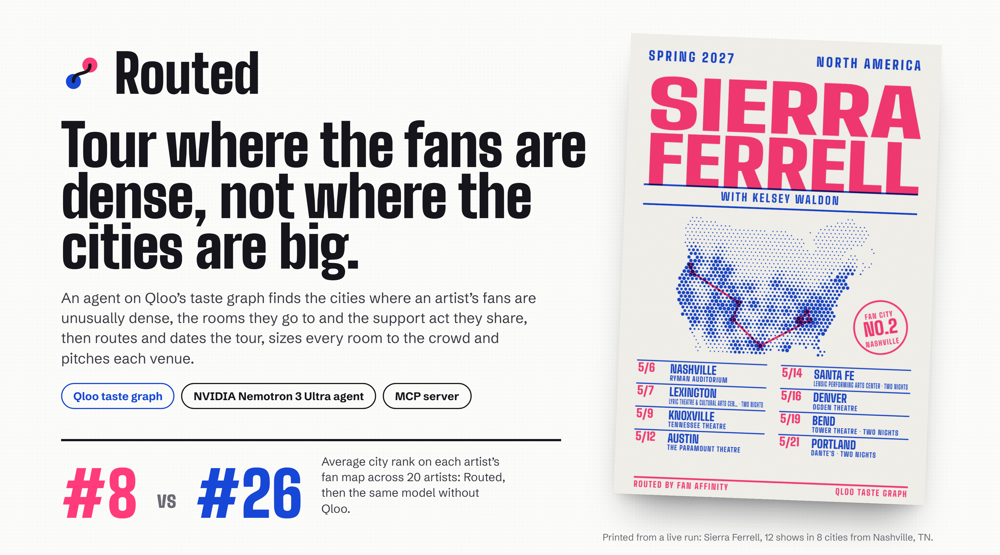
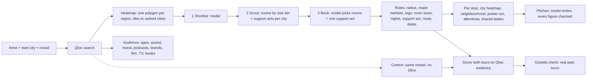

<p align="center"></p>

<p align="center">
  <a href="https://routed-tours.vercel.app"></a>
  <a href="https://youtu.be/UpdV5WY_UaM"></a>
  
  
  
  <a href="https://github.com/RohanGlitched/routed/actions/workflows/ci.yml"></a>
  <a href="LICENSE"></a>
</p>

<p align="center">
  <b><a href="https://routed-tours.vercel.app">Route a tour</a></b> ·
  <b><a href="https://routed-tours.vercel.app/tour/bnwvpmjuet">A finished tour book</a></b> ·
  <b><a href="https://routed-tours.vercel.app/proof">With and without Qloo</a></b> ·
  <b><a href="https://routed-tours.vercel.app/how">How it works</a></b>
</p>

**Routed books an independent artist's tour where their fans are dense, not where the cities are big.** Name an artist, a starting city and the usual crowd. An agent reads Qloo's taste graph for the cities where that artist's fans are unusually dense, the rooms those fans already go to and the artists who share their audience. It routes and dates the tour by rules a booker would sign, sizes every room to the crowd, finds the neighbourhood in each city where the fans are, and drafts a hold request for every venue with each figure traced to its source. Run without Qloo, the same model sent Sierra Ferrell to Toronto (#202 on her fan map), Atlanta (#90) and Dallas (#89); Routed's cities averaged #6.

It is for the people who route tours without a data team: independent artists, their managers, and the small agencies and promoters who book them.

## What a judge can check in a minute

- **Press "Route the tour"** on the home page (the form is pre-filled). A tour takes about a minute and streams its call sheet as it works: every Qloo question in plain words, with the exact request and what came back, and every rule that changed the agent's answer.
- **Open any day sheet.** The room holds a number with a source (Wikidata or a named web page) and fits the usual crowd, or it's a two-night stand, or the sheet says plainly what to ask the room. One support act plays every date. Under the date, a street-level map of the city: each dot a Qloo heatmap tile about 150 m across, the booked room marked, and the neighbourhood where the fans over-index most named from Qloo's own places there.
- **Scroll to "The same model, without Qloo".** The same model routed the same shows from memory before the agent looked anything up; both tours sit on one rank axis, scored on the artist's own heatmap.
- **[The benchmark](https://routed-tours.vercel.app/proof)** runs that for twenty artists, and adds an outside check Qloo didn't make: both tours against the cities each artist really played on a recent tour.
- **Add to calendar** gives the tour as an .ics file with every show, both nights of a two-night stand, travel days and days off; **Open in email** opens a pitch in your mail client; **Print the tour book** prints it. The tour book also says what the run cost: Qloo requests, model calls and tokens.

## Why it needs Qloo

A manager deciding where to play has a streaming dashboard that counts plays, not people who'd buy a ticket, and a model that knows which cities are big. Neither says where *this* artist's fans are unusually dense, which rooms they go to, which neighbourhood they live in, or who they'd also turn up for. That is exactly what Qloo's graph holds.

| Question a booker asks | Qloo call |
|---|---|
| Where do this artist's fans over-index? | `/v2/insights` `filter.type=urn:heatmap`, `signal.interests.entities=<artist>`, `filter.location=<one WKT polygon per region>` |
| Where inside this city? | `/v2/insights` `filter.type=urn:heatmap`, `filter.location=POINT(<city>)`, `filter.location.radius` (a few hundred tiles about 150 m across) |
| Which rooms there do those fans go to, for a crowd this size? | `/v2/insights` `filter.type=urn:entity:place`, `filter.tags` chosen by the crowd's size tier, `filter.location=POINT` + `radius`; arenas and amphitheatres asked for on their own from a crowd of 3,000 |
| Who should support? | `/v2/insights` `filter.type=urn:entity:artist`, `signal.location`, `filter.popularity.max` and `.min` (clearly smaller than the headliner, not unknown), then checked against Qloo's descriptions and genre tags |
| What do the headliner's fans and the support act's fans share? | `/v2/analysis/compare` `a.signal.interests.entities=<headliner>`, `b.signal.interests.entities=<support>` (style, genre and mood) |
| Who are the fans? All-ages or 21+? | `/v2/insights` `filter.type=urn:demographics` |
| What do they listen to, and how do they talk about it? | `/v2/insights` `filter.type=urn:tag` with `filter.tag.types` = `urn:tag:genre:music`, `urn:tag:artist:qloo` |
| Which podcasts, brands, films, TV and books? | `/v2/insights` `filter.type=urn:entity:podcast` / `brand` / `movie` / `tv_show` / `book` |
| Where would they see a poster, and go after? | `/v2/insights` `filter.type=urn:entity:place` with record store, bookshop and café tags within 2.5 km of the fans' hottest tile; then bar tags, per city |
| Is the audience growing? | `/v2/trending` (flat on the hackathon host for every artist tried, so it is shown only when it moves) |
| How well does each room match, ours and the model's? | `/v2/insights` `filter.type=urn:entity:place`, `filter.results.entities=<every room on both tours>` |

A typical eight-show tour makes about 70 Qloo requests, 4 model calls and about 23,000 tokens. Every Qloo call is listed, with its plain-words question, the exact request (never the key) and the answer, at the end of its tour book.

## With and without Qloo

Twenty artists, eight shows each, run on the live site on Oct 15, 2026 (first date May 6, 2027). The same model (Nemotron 3 Ultra), starting city and crowd size on both sides; the model alone gets the artist's name, Routed's agent gets Qloo. Each number is the average rank of a tour's cities among every touring city in the region on that artist's heatmap (lower is closer to the fans).

**Routed's cities averaged #8.3. The same model without Qloo averaged #26.2.**

| Artist | Routed | Model alone | Cities in common | Strongest city the model missed | Weakest city it chose |
|---|---|---|---|---|---|
| [Zach Bryan](https://routed-tours.vercel.app/tour/ycw8uxaih4) | #8.4 | #73.0 | 1 of 8 | Nashville (#1) | Los Angeles (#244) |
| [Tyler Childers](https://routed-tours.vercel.app/tour/h9unk4ctck) | #9.1 | #59.4 | 2 of 8 | Asheville (#2) | Chicago (#161) |
| [Caamp](https://routed-tours.vercel.app/tour/bbtnq56vfv) | #8.9 | #51.0 | 2 of 8 | Asheville (#3) | Toronto (#142) |
| [Waxahatchee](https://routed-tours.vercel.app/tour/9tjig3f979) | #10.5 | #41.9 | 2 of 8 | Austin (#4) | Atlanta (#101) |
| [Khruangbin](https://routed-tours.vercel.app/tour/43wf8pvmzv) | #7.3 | #33.6 | 2 of 8 | San Francisco (#1) | Atlanta (#68) |
| [Durand Jones & The Indications](https://routed-tours.vercel.app/tour/n25xq8c6j9) | #10.0 | #36.3 | 2 of 8 | New York (#3) | Indianapolis (#89) |
| [Ghost](https://routed-tours.vercel.app/tour/vfzwt8vpab) | #8.1 | #27.4 | 3 of 8 | Kassel (#3) | Copenhagen (#70) |
| [Knocked Loose](https://routed-tours.vercel.app/tour/fzpz68yjqg) | #6.0 | #24.5 | 2 of 8 | Philadelphia (#1) | Montreal (#53) |
| [Turnstile](https://routed-tours.vercel.app/tour/h2puujjejv) | #6.1 | #22.8 | 2 of 8 | Los Angeles (#2) | Montreal (#47) |
| [Cuco](https://routed-tours.vercel.app/tour/79kyqre6nk) | #12.1 | #27.4 | 2 of 8 | San Diego (#4) | Toronto (#80) |
| [MJ Lenderman](https://routed-tours.vercel.app/tour/2qhu4qsskk) | #6.8 | #20.5 | 3 of 8 | Chicago (#1) | Charleston (#50) |
| [Parcels](https://routed-tours.vercel.app/tour/d2ki8vdty2) | #8.6 | #16.4 | 4 of 8 | Paris (#1) | Milan (#37) |
| [Jamie xx](https://routed-tours.vercel.app/tour/thvmp9vhbc) | #6.0 | #12.6 | 5 of 8 | Brighton (#2) | Cardiff (#32) |
| [Alvvays](https://routed-tours.vercel.app/tour/nipn2k4cnd) | #9.6 | #14.8 | 6 of 8 | Ottawa (#4) | Detroit (#33) |
| [Arlo Parks](https://routed-tours.vercel.app/tour/gyr7wp8vpn) | #6.0 | #10.9 | 4 of 8 | Brighton (#2) | Dublin (#27) |
| [WET LEG](https://routed-tours.vercel.app/tour/cdnahzimdu) | #6.1 | #9.8 | 4 of 8 | Brighton (#2) | Dublin (#32) |
| [Japanese Breakfast](https://routed-tours.vercel.app/tour/bgyrxqguyf) | #9.3 | #12.5 | 4 of 8 | Austin (#5) | Toronto (#32) |
| [Fontaines D.C.](https://routed-tours.vercel.app/tour/avqijwpkgy) | #5.6 | #8.4 | 6 of 8 | Cork (#5) | Cardiff (#19) |
| [JPEGMAFIA](https://routed-tours.vercel.app/tour/ecm4c8q9xe) | #7.1 | #7.9 | 7 of 8 | Washington (#4) | Baltimore (#10) |
| [Clairo](https://routed-tours.vercel.app/tour/kvda9edhz9) | #13.4 | #13.0 | 6 of 8 | Montréal (#15) | Philadelphia (#26) |

Qloo earns its keep where an artist's audience doesn't follow the population: the model alone sent Zach Bryan to Los Angeles (#244 on his map) and Tyler Childers to Chicago (#161), while Qloo put their strongest fans in Nashville and Asheville. The gap is smallest in the UK and Ireland, where touring cities are few and the biggest ones are also where the fans are, and for Clairo the model alone did slightly better.

Read this with Qloo's own ruler in mind: Routed chooses from the heatmap ranking it is then scored on, so the number shows how far a model routing from memory strays from where the taste graph puts the fans, not that the graph is right. The [benchmark page](https://routed-tours.vercel.app/proof) says so, gives the median stop and the share of stops in each artist's top ten, shows the exact baseline prompt, and names where the model alone keeps up. A model-alone city is placed by its name, then by the named room's coordinates on Qloo, then by Qloo's locality search; a stop that resolves to a town with no touring city near it counts last, and one that can't be placed at all is left out rather than counted against the model.

The benchmark tours were routed on the build of Oct 15 (commit d81a398); their rooms were then re-sized under the stricter capacity reader and the bar, pub and orchestra-hall rules that landed the same day (`/api/admin/resize`, which changes rooms and nights, never cities). Fan-map ranks are unchanged by that.

### An outside check

A ruler Qloo didn't make. For 19 of the artists (no recent UK headline tour could be found for Jamie xx), [data/real-tours.json](data/real-tours.json) holds the cities of one recent headline tour they announced and played, from Wikipedia tour articles, press listings and label releases, every source linked; festivals, support slots and in-stores left out. Suburbs and venue towns count as the touring city within 60 km (Morrison is Denver; Wolverhampton is Birmingham). How many of the cities each tour booked did the artist really play?

**49% of Routed's cities were on the artist's real tour (74 of 152); 48% of the model alone's were (73 of 152).** A tie.

| Artist | Real tour | Routed's cities played | Model alone's cities played |
|---|---|---|---|
| Alvvays | Blue Rev tour, spring 2024 North American leg, 2024 (17 cities) | 0 of 8 | 0 of 8 |
| Arlo Parks | Ambiguous Desire world tour, opening UK album-launch run (April 2026), 2026 (6 cities) | 3 of 8 | 3 of 8 |
| Caamp | Copper Changes Color tour (2025 US tour), 2025 (28 cities) | 3 of 8 | 4 of 8 |
| Clairo | Charm Tour (2024 North American leg), 2024 (22 cities) | 6 of 8 | 7 of 8 |
| Cuco | Ridin' Tour (2025 North American leg), 2025 (28 cities) | 7 of 8 | 5 of 8 |
| Durand Jones & The Indications | Flowers Tour 2025 (fall North American tour), 2025 (34 cities) | 8 of 8 | 6 of 8 |
| Fontaines D.C. | Romance tour, UK and Ireland leg, 2024 (9 cities) | 4 of 8 | 6 of 8 |
| Ghost | Skeletour World Tour (2025 European leg), 2025 (19 cities) | 5 of 8 | 5 of 8 |
| Japanese Breakfast | The Melancholy Tour (spring 2025 North American leg), 2025 (11 cities) | 1 of 8 | 2 of 8 |
| JPEGMAFIA | Lay Down My Life Tour (2024 North American leg), 2024 (28 cities) | 6 of 8 | 5 of 8 |
| Khruangbin | A La Sala Tour 2024 (North American dates), 2024 (20 cities) | 3 of 8 | 3 of 8 |
| Knocked Loose | Fall 2024 North American headline tour, 2024 (20 cities) | 2 of 8 | 1 of 8 |
| MJ Lenderman | Manning Fireworks tour, winter 2025 North American leg (with Wild Pink), 2025 (24 cities) | 0 of 8 | 3 of 8 |
| Parcels | 2025 European arena tour (LOVED era), 2025 (5 cities) | 3 of 8 | 1 of 8 |
| Turnstile | Never Enough Tour (fall 2025 North American leg), 2025 (21 cities) | 7 of 8 | 2 of 8 |
| Tyler Childers | Mule Pull '24 Tour (North American dates), 2024 (27 cities) | 2 of 8 | 3 of 8 |
| Waxahatchee | Tigers Blood Tour 2024, 2024 (36 cities) | 8 of 8 | 7 of 8 |
| WET LEG | moisturizer tour, autumn 2025 UK and Ireland leg, 2025 (8 cities) | 2 of 8 | 4 of 8 |
| Zach Bryan | The Quittin Time Tour, 2024 (43 cities) | 4 of 8 | 6 of 8 |

What it means: Routed matches real touring as well as a model that may have read these very announcements, while booking cities about three times closer to where Qloo puts the fans. What it can't mean: a past tour is one booker's answer, made with ticket data neither side has, and a big act's tour plays twenty to forty cities, so eight good guesses can all be on it.

## The booking rules

Each rule is deterministic, tested, and logged on the call sheet when it changes the agent's answer.

- **Radius clause, by region**: no two shows closer than 150 km in North America, 120 km in mainland Europe or 60 km in the UK and Ireland, where a real tour plays London and Brighton. Never between two major markets of 1.5 million or more: New York and Philadelphia each carry a show.
- **Major markets stay**: a city of 1.5 million or more in the artist's top ten is always on the tour when the route can reach it, and the smaller city inside its radius gives way. No UK tour without London.
- **No leg over 1,800 km** between two shows (two days in the van). A tour split across two coasts keeps the group with the artist's strongest cities and replaces the rest with cities that join it; a long leg left over is broken by the swap that gives up the least fan strength; one that no city with rooms can close stays, and its day sheet says so.
- **Rooms sized to the crowd**: a room holding 60–250% of the usual crowd for one night; failing that, 30–60% for two nights (both dates go on the calendar); then up to four times the crowd in a reduced configuration; then a room whose capacity couldn't be found (the sheet says to ask). A room known to miss by more is booked only when nothing else is left. No stadium below a 30,000 crowd, no housing, no gallery or art centre for 700+, no pub, bar or food-cart yard for 1,000+, no café or club for 3,000+, no orchestra's own hall for a rock, pop or hip-hop act.
- **Capacities, one number per room**: Wikidata's maximum-capacity property first (the item must be the room itself, not a hall inside it: Nordstrom Recital Hall is not Benaroya Hall), then a web page that names the room in whole words, names the city, and puts the number next to the name. Answers live in one versioned index, keyed by Qloo's room id, so a room never shows two numbers. Social posts, LinkedIn, YouTube and articles about planned buildings are not sources.
- **One support act for the whole run**, as on a real tour: the agent's most frequent pick. Never the headliner itself, a shared name, the headliner's own member or a member of another band (by Qloo's description: Grian Chatten fronts Fontaines D.C.; Kirk Hammett plays in Metallica), never as big as the headliner, and sharing a specific genre or two umbrella ones (no bluegrass under post-punk). The other artists each city suggested are listed as local options.
- **The calendar**: the shortest drive (nearest neighbour, then 2-opt), at most 8 hours of driving on a show day, travel days for longer jumps, a day off after five shows.
- **Clean names**: venue names cleaned for the poster ("Think Tank?" was one), two cities with one name printed with their state, and census-place market names replaced by the city a booker writes (Ashland, not Meads; Palm Springs, not Indio; Margate, not Saint Peters).

## Inside each city

For every stop Routed asks Qloo for the heatmap of that one city: a few hundred tiles about 150 m across. A rule finds the hottest tile, names the neighbourhood from the shops and bars Qloo files there (with how Qloo characterises it: a creative hub, a historic district), measures the booked room against it, and anchors the poster run on it, so posters go up where the fans live. The map sits under the date on every day sheet, and the pitch can say "the venue sits in Buckman, where the heatmap shows the strongest concentration" because the evidence line does.

## Use it from your own agent

Routed is also an MCP server (Streamable HTTP). Add `https://routed-tours.vercel.app/api/mcp` to any assistant that supports remote MCP servers and it gets five tools:

| Tool | What it does |
|---|---|
| `fan_map` | Where an artist's fans over-index in North America, the UK and Ireland, or mainland Europe |
| `fan_neighbourhoods` | Where inside one city, with the record stores and cafés there for a poster run |
| `fan_profile` | Who the fans are: door advice, sound, mood, podcasts, brands, films, TV, books |
| `route_tour` | A whole tour in about a minute, with the dates, rooms, support act and a link to the tour book |
| `get_tour` | Reads back a tour book by its link |

## How it works



- **The agent (NVIDIA Nemotron 3 Ultra on Nebius Token Factory)** works in three moves: it shortlists cities from the ranked heatmap with a few alternates, Routed scouts each one through Qloo, and the model books a room per city and one support act for the run. Every call returns strict JSON with reasoning off.
- **Rules decide what must be exact** (above). When a rule changes the room the model chose, the model's sentence about the stop is replaced by a rule's, so a wrong name never stays on the page.
- **Pitches are checked**: Nemotron writes each hold request from that stop's evidence lines only; every number in it must appear in the evidence (a two-night stand names both dates) or it is struck through on the page. A stop's one-line reason is checked against what the booking agent was shown for that city.
- **City strength** is a tile's Qloo affinity times its popularity, both from one heatmap call per region. Affinity and popularity are percentiles within the response they came in (measured: both run evenly from 0 to 1 in every response), so two countries asked separately would each have a "1.0" tile; one polygon, one scale.
- **The artist someone typed wins** over Qloo's first guess ("Wednesday" is not "Wednesday Campanella"), and the other matches are offered on the tour book.
- **Fallbacks**: with no model key, a spent daily budget or a model error, the same steps run as a fixed plan with template pitches, and the tour book says which ran. A run survives a closed tab; the record is saved as it goes.

## Run it

```bash
git clone https://github.com/RohanGlitched/routed && cd routed
npm install
cp .env.example .env.local   # then fill in the keys
npm run dev                  # http://localhost:3000
npm test                     # 55 unit tests: every booking rule, scoring, capacity parsing, evidence checks (both nights of a two-night stand), the outside check, the city map, the calendar file
```

| Variable | Needed for |
|---|---|
| `QLOO_API_KEY` | Every Qloo call (hackathon host `https://hackathon.api.qloo.com`, header `X-Api-Key`) |
| `QLOO_BASE_URL` | Optional, defaults to the hackathon host |
| `NEBIUS_API_KEY` | The agent, the control group and the pitches. Without it, the fixed plan and template pitches run |
| `TAVILY_API_KEY` | Optional: room capacities use Wikidata first and Tavily's keyless mode second; set `TAVILY_USE_KEY=1` to search with this key instead |
| `GCS_BUCKET` + `GCS_WIF_AUDIENCE` | Tours, the daily counters and the room index in a Google Cloud Storage bucket, keyless: the function's Vercel OIDC token is exchanged for a token on the bucket (or `GCS_SA_KEY`, a base64 service-account JSON; or `BLOB_READ_WRITE_TOKEN` for Vercel Blob). Without any, tours are files under `.data/` |
| `DAILY_MODEL_CAP`, `QLOO_DAILY_CAP`, `MCP_DAILY_CAP` | Daily allowances for the public demo (model runs, Qloo requests, tours routed through the MCP endpoint) |
| `ADMIN_TOKEN` | Optional: shelving tours, the benchmark (`scripts/bench.mjs`), re-sizing stored tours and adding measured capacities |

`node scripts/probe-qloo.mjs "Artist"` measures every Qloo call Routed depends on and saves the raw responses (gitignored: Qloo's data isn't published here). `node scripts/bench.mjs <url>` runs the benchmark; `npx tsx scripts/bench-table.ts <url> <ids>` prints the two tables above from the finished tours; `scripts/measure-rooms.ts` measures rooms a live run couldn't (Wikidata rate-limits shared serverless addresses) and adds them to the live index.

## What Routed doesn't know

- Qloo affinity says where fans over-index, not how many tickets will sell. It's the first question a booker asks, not the last. The main benchmark measures with Qloo's own ruler and says so; the outside check is a tie.
- About a quarter of booked rooms still have no confirmed capacity (clubs Wikidata doesn't know, pages that don't say); the sheet says to ask the room.
- Availability, holds, offers, guarantees and ticket prices come from the rooms; the pitch asks for them. The radius clause is distance, not time, and festival weeks aren't checked.
- The figure check asks whether each number in a pitch appears in the stop's evidence. A true figure written another way is struck; a wrong figure that happens to match another number passes.
- Qloo's trend series is flat on the hackathon host for every artist tried, so momentum is shown only when it moves.
- Nothing here has been validated with a working booker yet.
- Routed sends Qloo only public names (artists, cities, venues). It collects no personal data.

## Credits

Taste data from [Qloo](https://www.qloo.com). Agent and pitches by NVIDIA Nemotron on Nebius Token Factory. Capacities via [Wikidata](https://www.wikidata.org) and Tavily. Cities from [GeoNames](https://www.geonames.org) (CC BY 4.0); coastlines from Natural Earth. Real tour dates from the Wikipedia articles and press listings linked in data/real-tours.json. Type: Big Shoulders and Schibsted Grotesk.

MIT licence.
